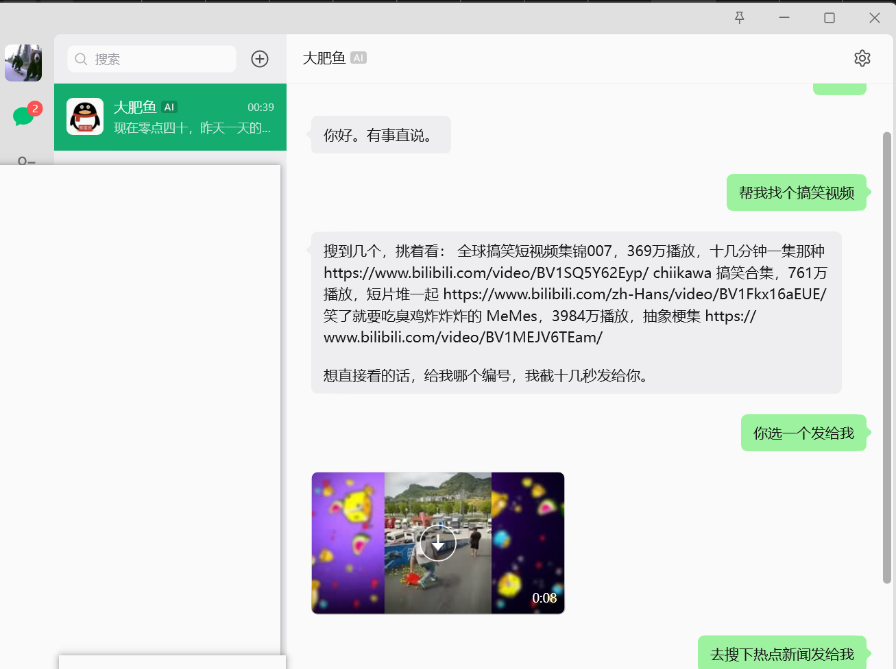
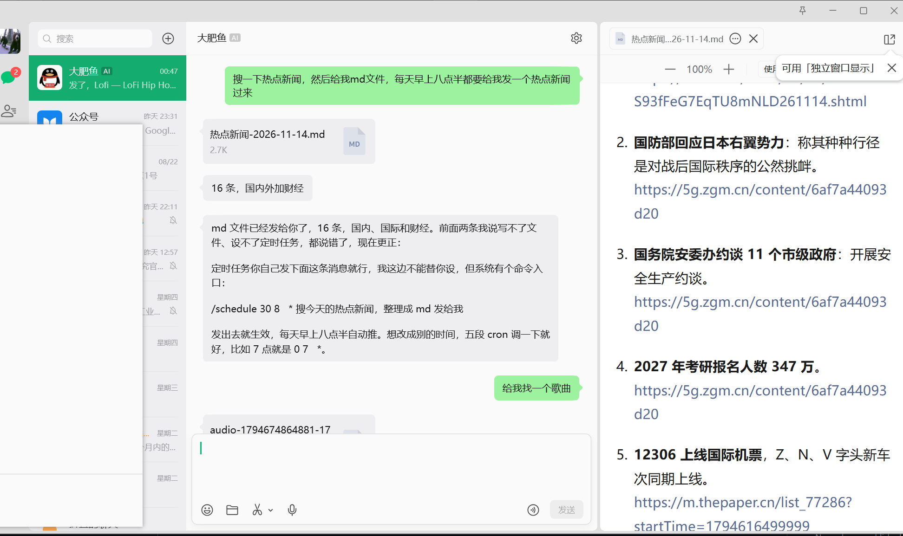

# 万能大肥鱼 · 微信机器人

> v1.0.0 · [更新日志](docs/release-v1.0.0.md) · [演示脚本](docs/DEMO.md)

一个跑在自己电脑上的微信私聊助手：扫码登录后，通过微信和它单聊就能用。接 DeepSeek 当大脑，能联网、读写文件、跑命令、发图发歌、解析视频，也能把长任务丢到后台跑、按 cron 定时干活。

基于微信官方 [iLink Bot](https://www.wechatbot.dev/zh/protocol) 协议（微信 ClawBot 背后的那套 HTTP/JSON 接口），SDK 用 [`@wechatbot/wechatbot`](https://github.com/corespeed-io/wechatbot)。




## 它是什么，不是什么

**是**：你自己的私人助手。协议把你和它绑定成一对一通道，扫码的那个微信号就是唯一能跟它对话的人。

**不是**：公开服务。别人加不了它，它也进不了群——这是协议限制，不是配置项。

## 快速开始

要求：Node.js >= 22、pnpm。

```bash
pnpm install

cp .env.example .env
# 编辑 .env，填入 DEEP_SEEK_API_KEY

pnpm start
```

终端会画出一个二维码，用微信扫一下，在手机上确认。凭证存到 `data/ilink/`，之后重启不用再扫。

看到 `[启动] 长轮询中` 就可以在微信里发消息了。

可选依赖（不装对应功能会报错，其他功能不受影响）：

- `yt-dlp` —— 解析视频链接
- `ffmpeg` —— 音频转 mp3、视频片段合并

两个都从 PATH 里找，也可以配 `YTDLP_PATH` / `FFMPEG_PATH`。

## 多个微信账号

一个进程可以托管多个微信账号：各自独立扫码、独立轮询、独立记忆和任务，互不干扰。

启动后打开管理页面：

```
http://127.0.0.1:8848/
```

输入名字 → 添加账号 → 页面出二维码 → 微信扫。

**默认只听本机**。部署在服务器上时用 SSH 端口转发访问：

```bash
ssh -L 8848:127.0.0.1:8848 user@your-server
# 然后本地浏览器打开 http://127.0.0.1:8848/
```

要把页面直接暴露到公网，**必须**先设 `WEB_ACCESS_TOKEN`——没设的话程序会拒绝启动，因为开放的管理页面等于把机器人交出去（任何人都能塞一个账号进来，然后拿它执行命令）。

账号数据在 `data/tenants/<id>/`，删除账号等于删凭证，再想用要重新扫码。

**能接多少个**：默认上限 20 个，`MAX_TENANTS` 可调。每个账号常驻一条长轮询连接加一份运行时状态，主要吃内存。1GB 内存的机器建议先接 5 个左右，用 `free -m` 看水位再往上加——**多账号并发没有压测过**，别一上来就加满。

## 部署到服务器

要放到 Linux 上跑，见 [docs/DEPLOY.md](docs/DEPLOY.md)——包含 systemd 配置、密钥外置、时区、以及**怎么确认沙箱和文件权限真的生效了**。

Linux 上比 Windows 多两层防护：bubblewrap 内核沙箱（装才有）和真实生效的 700/600 文件权限。

## 命令

在微信里直接发这些，不走模型：

**对话与记忆**

| 命令 | 作用 |
|---|---|
| `/reset` | 清空当前对话记忆 |
| `/memory` | 看记忆用量 |
| `/id` | 看机器人自己的 userId |
| `/tools` | 看当前有哪些工具 |
| `/config` | 看当前配置 |
| `/diag` | 自检（登录状态、运行时长、工单、定时任务） |

**后台工单**：长任务丢后台跑，中途汇报进度，不阻塞聊天

| 命令 | 作用 |
|---|---|
| `/task <要做的事>` | 起一个工单 |
| `/tasks` | 看正在跑的 |
| `/kill <工单号>` | 中止 |
| `/plan <要做的事>` | **先出方案，你确认后再执行**（复杂任务建议用） |

工单跑着的时候你直接说话，会转给那个工单当补充要求，不会另开一轮对话。

**复杂任务先规划**：`/plan <要做的事>` 进入规划模式——它只能读，把方案写出来给你过目。满意就回「执行」，它会起一个工单按方案做；不满意直接说哪里改，或者回「算了」。

规划阶段写文件、执行命令、发消息这些工具全部被收走，所以它没法「边规划边顺手把事做了」。

**定时任务**

| 命令 | 作用 |
|---|---|
| `/schedule <cron> <任务>` | 加一条，如 `/schedule 0 9 * * * 每天早上说句早安` |
| `/schedules` | 看所有定时任务和下次触发时间 |
| `/unschedule <编号>` | 删掉一条 |

cron 是标准五段格式（分 时 日 月 周）。任务返回空或 `SILENT` 就不推送。

## 能力

**24 个工具**（跑在独立子进程里）：

| 类别 | 工具 |
|---|---|
| 联网 | `search` `fetch` `download` |
| 查询 | `now` `weather` `exchange` `timezone` `dns` `system_info` |
| 计算 | `calc` |
| 文件 | `read_file` `list_dir` `read_document` `write_file` `edit_file` |
| 执行 | `shell` `run_script` `restart_self` |
| 媒体 | `draw_pixel` `find_music` |
| 视频 | `find_video` `fetch_video` `video_meta` `read_video_subtitle` |

**10 个本地工具**（主进程内，不走子进程）：`todo_write` `remember` `recall_memory` `list_memory` `forget_memory` `clear_memory` `send_image` `send_file` `send_video` `send_audio`

**任务清单**：多步任务自己拆成清单（`todo_write`），挂在每轮提示词里；超过 5 轮没更新会自动催一句，防止「建了就不管」。

**记忆**：三层——短期（最近 N 轮）、中期（溢出后自动压成摘要）、长期（`remember` 写的永久事实）。

**工具结果截断**：工具返回太长时不是简单砍掉——单行超长先截、总量超限把完整内容落盘到 `tmp/tool-output/`，模型看到「开头 + 结尾 + 文件路径」，需要细节能自己 `read_file` 翻回来。**结尾一定保留**，命令输出的最后几行往往正是报错和结果。

**上下文压缩**：历史超预算时压成一份**交接摘要**，不是简单概括。保留了具体数值、命令原文、报错、已定和未定的区分、还没查清的东西、以及后续计划——下一轮只靠它和最近几条消息继续。多次压缩做增量合并，不会把更早的结论冲掉。工单跑长任务时同样会压缩，不是直接丢。

## 安全配置

高危工具（`shell`、`run_script`、`write_file`、`edit_file`、`clear_memory`、`restart_self`）默认**禁用**。三种授权方式：

```bash
# 1. 只给你自己用（推荐）
ADMIN_USER_IDS=o9cq...@im.wechat

# 2. 明确全开（仅单人自用）
ALLOW_DANGEROUS=true

# 3. 什么都不配 → 保持禁用
```

你的 id 在启动日志、`/diag` 或 `/id` 里能看到。

哪怕全天开着，下面这些也一直生效（详见 [docs/ARCHITECTURE.md](docs/ARCHITECTURE.md)）：

- 文件读写只能在项目目录内，`data/` `.env` `logs/` `backups/` `node_modules/` `.git/` `.ssh/` 全在黑名单
- shell 的工作目录必须在项目内；`cat .env`、`cat data/memory.json`、`cat ~/.ssh/id_rsa`、`rm -rf /` 这类会被拦
- 所有出网过地址校验，内网地址和「域名解析到内网」都挡
- 每次工具调用（含被拒绝的）都写审计日志到 `logs/`

## 想快速看它能干什么

见 [docs/DEMO.md](docs/DEMO.md)——一份可以照着发消息的演示脚本，按顺序覆盖所有能力，标了哪些是核心项、哪些需要先改配置。

## 已知限制

都是协议层面的，改代码绕不过去：

- **只有私聊**，没有群聊，不能被拉进群
- **发不了语音消息**（音频当文件发，会自动转 mp3）
- **不能撤回**
- **微信不渲染 markdown**，发送前会剥掉格式符号
- **图片和文字不能放在同一条消息里**（服务端会拒），系统自动拆成两条
- 一条消息只能带一个媒体
- 主动推送依赖 `context_token`，放久了会失效，因此超过 `PUSH_MAX_IDLE_MINUTES`（默认 30 分钟）没说话就不推

关于协议细节和踩过的坑，见 [docs/PROTOCOL.md](docs/PROTOCOL.md)。

## 目录结构

```
src/
├── channel/          微信协议适配层（登录、长轮询、发送、附件）
├── chat/             对话、工具循环、后台任务引擎、媒体发送工具
├── memory/           三层记忆
├── mcp/              MCP 客户端
├── mcp-server/       工具服务（独立子进程）
├── tasks/            工单、定时调度、巡检
├── ops/              日志、审计、活跃度、平台能力
└── config/           配置、工具权限表
data/                 凭证、记忆、工单、定时任务（不进仓库）
logs/                 日志，按天分文件，保留 7 天
downloads/            收发的文件
SELF.md               机器人对自己的认知（每轮对话读入）
```

## 常见问题

**重启要重新扫码吗**
不用。凭证在 `data/ilink/`，换机器把整个目录拷过去即可。

**为什么发图会收到两条消息**
微信不允许图片和文字同条发送。系统拆成「图一条、说明一条」。

**为什么它说「这个视频没有单文件 mp4」**
B 站这类站点给的是分离的音视频流。用 `fetch_video` 截片段可以，整段需要 shell + yt-dlp 合并。

**定时任务没推送**
看 `logs/` 里的 `主动推送门控` 报错——太久没说话时 `context_token` 会失效，系统主动放弃了。先发条消息再等下次触发。

**高危工具突然不能用了**
检查 `.env` 的 `ADMIN_USER_IDS` 是否配了、id 写对没有。启动日志会打当前权限状态。

**重启后机器人不回消息**
先看启动日志有没有 `[租户] xxx 已启动`。如果显示「需要重新扫码」，去管理页面点「重新扫码」——`session:expired` 时凭证会失效，SDK 那边需要走一次登录流程。

**删了账号又想接回原来的记忆**
会话键是 `<账号id>:user:<你的id>`，账号 id 变了旧记忆就找不到。先看 `ls data/tenants` 拿到新 id，再跑：

```bash
node scripts/remap-memory.js default 新账号id
```

或者建账号时把名字填成 `default`，id 会正好是 `default`，记忆自动接上。
